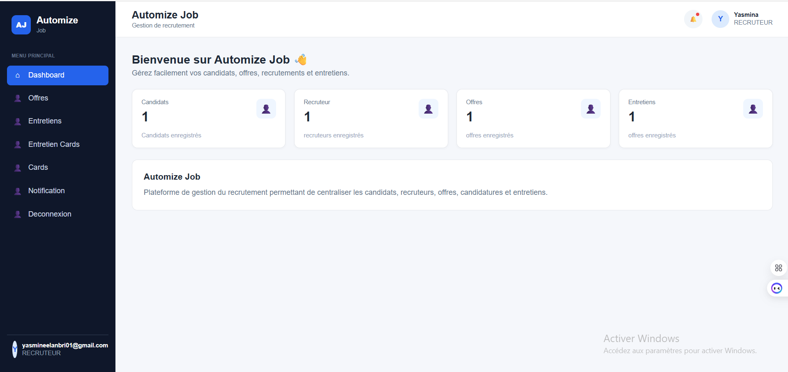

# 🚀 Automated Recruitment 



An end-to-end full-stack automated recruitment and candidate management platform built with modern web technologies, scalable backend architectures, and a responsive frontend interface.

---

## 🛠️ Tech Stack & Architecture

### **Backend**
* **Framework:** Django & Django REST Framework (DRF)
* **ORM & Database:** Django ORM with relational data models
* **Secondary Services / Scripts:** Node.js
* **Authentication:** JWT (JSON Web Tokens) with secure token rotation
* **API Design:** RESTful APIs with comprehensive serialization and data validation

### **Frontend**
* **Core Framework:** React.js with TypeScript (`React.ts`)
* **Languages:** TypeScript, JavaScript (ES6+)
* **UI/UX Design:** UI prototyping & system components designed in **Figma**
* **HTTP Client:** Axios (custom instances, request/response interceptors for JWT)

---

## ✨ Key Features

- [x] **Secure Authentication & Authorization:** Full JWT authentication lifecycle (Login, Register, Token Refresh).
- [x] **RESTful API Integration:** Asynchronous data fetching and error handling via Axios.
- [x] **Data Serialization & Relational Models:** Complex relational database architecture powered by Django ORM & DRF serializers.
- [x] **Recruitment Workflow:** Candidate tracking, application management, and status updates.
- [x] **UI/UX Prototype Integration:** High-fidelity UI implementation aligned with Figma design specs.

- [x] **Dynamic Endpoints Management:** Centralized `url.tsx` configuration for smooth staging-to-production API requests.
- [x] **Figma-Driven UI:** Modern and responsive frontend built with React TypeScript.
---

## ⏳ Work in Progress & Roadmap

- [ ] **Recruiter Scheduling Module:** Fine-tuning and UI/UX design enhancement for interview planning & recruiter scheduling dashboard.
- [ ] **Automated Candidate Filtering:** Enhanced automated workflow features.
- [ ] **Email Notifications:** Automated email triggers for candidates upon status updates.

---


## 💻 Getting Started Locally

### Prerequisites
* Python 3.12.10 & Django
* Node.js & npm / yarn
* Git

### Installation

1. **Clone the repository:**
   ```bash
   git clone [https://github.com/YasmineElanbri001/plateforrme_recrutement_jobAutomize.git](https://github.com/YasmineElanbri001/plateforrme_recrutement_jobAutomize.git)
   cd plateforrme_recrutement_jobAutomize